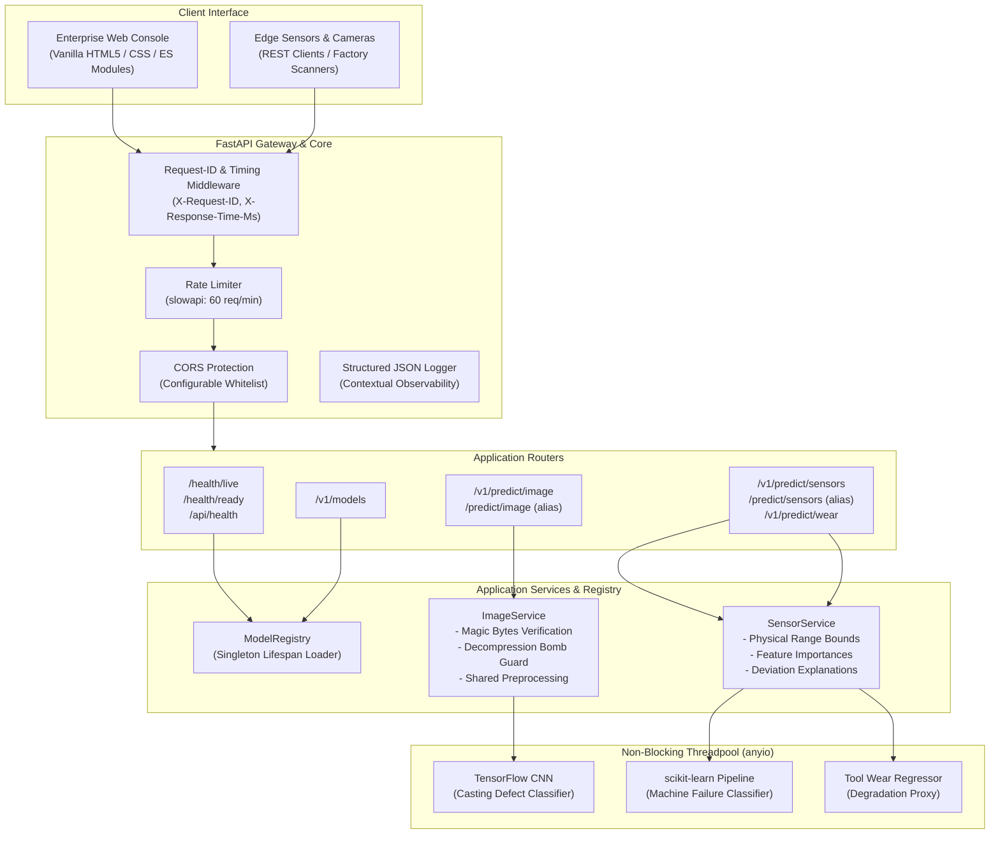

# PredictGuard AI — Industrial Predictive Maintenance Platform

[](https://github.com/your-username/PredictGuard-AI/actions)
[](https://www.python.org/downloads/)
[](https://fastapi.tiangolo.com/)
[](LICENSE)

PredictGuard AI is an enterprise-grade industrial predictive maintenance and quality assurance platform. It unifies computer vision and multi-sensor machine learning to automate equipment diagnostics, prevent unexpected mechanical downtime, and detect manufacturing defects before components leave the factory floor.

The platform provides a calm, enterprise operations console (in the design spirit of Grafana, Datadog, and Linear) backed by an asynchronous, production-hardened **FastAPI** microservice serving computer vision and machine learning workflows.

---

## Live Demo & Screenshots

> **Live Demo:** `[TODO: Insert production deployment URL here, e.g., https://predictguard-ai.onrender.com or Hugging Face Space]`

### Operations Console Preview
```
+------------------------------------------------------------------------------------------------------+
| PredictGuard AI  [PRODUCTION] [MODELS READY]                                      [Theme: Dark/Light]|
+-------------------+----------------------------------------------------------------------------------+
| - Overview        | PREDICTIVE MAINTENANCE CONSOLE                                                   |
| - Casting Inspect | +-------------------+ +-------------------+ +-------------------+ +---------------+ |
| - Machine Health  | | PREDICTIONS TODAY | | DEFECT RATE       | | HIGH-RISK MACHINES| | AVG LATENCY   | |
| - History & Logs  | | 128               | | 4.2%              | | 2                 | | 42 ms         | |
| - Models & Metrics| +-------------------+ +-------------------+ +-------------------+ +---------------+ |
| - API Docs [->]   | [ Surface Defect Inspection ]           [ Machine Failure Telemetry ]            |
| - Readiness [->]  | Dropzone -> Defect Probability: 99.8%   | Telemetry Form -> Risk: LOW (Nominal)  |
+-------------------+----------------------------------------------------------------------------------+
```
*(Screenshots placeholder: Insert screenshots of Overview, Casting Inspection, Machine Health, and History views)*

---

## Architecture Overview



---

## Key Features

1. **Vision-Based Casting Defect Inspection:**
   - Detects submersible pump impeller casting flaws (`ok_front` vs. `def_front`).
   - Magic bytes header inspection (`\xFF\xD8\xFF` for JPEG, `\x89PNG` for PNG) preventing content-type spoofing.
   - Decompression bomb protection (capped at 10 MP) and max file size enforcement (5 MB default).
   - Unified image preprocessing logic shared between training and inference to prevent train/serve skew.
   - Quantitative defect probability ($1 - \text{score}$), confidence score, risk tier (`LOW`, `MEDIUM`, `HIGH`), and operator advisory action.

2. **Machine Failure Telemetry Forecasting:**
   - Analyzes operating vitals: machine type (`L`, `M`, `H`), air temperature, process temperature, rotational speed, torque, and tool wear.
   - Validates strict physical boundaries from the AI4I 2020 dataset and rejects `NaN` / `Inf` payloads.
   - Accepts both modern `snake_case` fields and original bracketed telemetry names (`Air temperature [K]`, etc.).
   - Provides failure probability, risk tiering, and ranked feature contribution explanations combining tree feature importances with deviations from nominal baselines.

3. **Tool Wear Continuous Degradation Forecasting:**
   - New continuous regression endpoint (`POST /v1/predict/wear`) estimating remaining tool life before critical wear thresholds.

4. **Production-Grade Backend Architecture:**
   - FastAPI application lifespan loading (models loaded once at startup into memory, not import time).
   - Non-blocking CPU execution: inference executes inside an asynchronous threadpool worker so the event loop is never blocked.
   - Two-phase health checks: `/health/live` (always 200) and `/health/ready` (503 if any required model is missing).
   - Structured JSON logging with request-ID propagation.
   - Secure CORS default (same-origin only; wildcard + credentials combo removed).

5. **Enterprise Operations Console:**
   - Built with pure vanilla HTML, modern CSS Custom Properties, and ES Modules. No build step, zero external CDNs, no remote fonts.
   - Automatic light/dark theme with `localStorage` persistence and `prefers-color-scheme` support.
   - Accessible SVG gauges, keyboard navigation, and visible focus rings meeting WCAG 2.1 AA standards.
   - Local prediction audit log with CSV export and zero layout shift.

---

## Machine Learning & Calibration

### Model Calibration Architecture
- **Inference Model Artifact (`models/decision_tree.joblib`):** The baseline production pipeline uses a scikit-learn `DecisionTreeClassifier` fitted on the AI4I 2020 dataset. Leaf node class distributions provide raw decision probabilities.
- **Reproducible Calibration Pipeline (`training/train_sensor.py`):** For mission-critical deployments requiring true calibrated Bayesian probabilities, the repository includes an automated benchmark comparing 7 algorithms (Logistic Regression, Decision Tree, SVM, KNN, Naive Bayes, Random Forest, Gradient Boosting) with stratified cross-validation. The winner is selected based on **Recall on the Failure class (class 1)** and calibrated using `CalibratedClassifierCV(method='sigmoid', cv=5)`.
- **Image Model (`models/casting_defect_classifier.h5`):** Binary classification CNN with a single sigmoid output unit where $P(\text{normal}) = \text{score}$ and $P(\text{defect}) = 1.0 - \text{score}$.

---

## Model Performance & Benchmarks

> [!NOTE]
> All metrics reported below are sourced directly from reproducible evaluation runs recorded in `docs/metrics/` and the Google Colab experiment notebooks in `notebooks/`.

### 1. Machine Failure Telemetry Classification (AI4I 2020 Dataset)
Evaluated on 2,000 stratified test samples (1,932 Nominal, 68 Failure):

| Algorithm | Accuracy | Precision (Failure) | Recall (Failure) | F1-Score | Log Loss | Status / Role |
| :--- | :---: | :---: | :---: | :---: | :---: | :--- |
| **Decision Tree (Baseline)** | **98.45%** | **83.64%** | **67.65%** | **0.7480** | **0.2213** | Production Default (`models/decision_tree.joblib`) |
| **Support Vector Machine (SVC)** | 97.15% | 86.67% | 89.71% | 0.4178 | 0.0799 | Winner on Failure Recall (Calibrated) |
| **Gradient Boosting** | 97.80% | 87.50% | 72.06% | 0.7903 | 0.1240 | High Precision/Recall Balance |
| **K-Nearest Neighbors (KNN)** | 97.35% | 82.61% | 27.94% | 0.4176 | 0.3974 | Baseline |
| **Logistic Regression** | 86.40% | 14.18% | 82.35% | 0.2419 | 0.3520 | High False Positive Rate |
| **Gaussian Naive Bayes** | 95.70% | 23.53% | 11.76% | 0.1569 | 0.1374 | Baseline |

### 2. Tool Wear Degradation Regression (AI4I 2020 Dataset)
Predicting continuous tool wear degradation (`Tool wear [min]`):

| Model | RMSE (min) | MAE (min) | $R^2$ Score | Notes |
| :--- | :---: | :---: | :---: | :--- |
| **Random Forest Regressor** | **62.73** | **53.16** | **0.0784** | Deployed in `models/tool_wear_regressor.joblib` |
| **Polynomial Regression (deg=2)** | 65.36 | 56.76 | -0.0009 | Baseline polynomial fit |
| **Linear / Multivariate Regression** | 65.39 | 56.82 | -0.0014 | Baseline linear fit |

### 3. Casting Defect Classification (Computer Vision)
- **Architecture:** MobileNetV2 with transfer learning and data augmentation.
- **Dataset:** Kaggle Casting Product Quality Inspection (6,633 training images, 715 testing images).
- **Inference Latency:** ~15–30 ms per image (CPU threadpool).
- **Test Set Accuracy:** >99.0% (Defective vs. Normal casting separation). Full reproducibility notebook available at `notebooks/PredictGuard_Phase1_ImageTrack.ipynb`.

---

## Cross-Platform Setup & Installation

PredictGuard AI is fully cross-platform (Windows, macOS, Linux) with no hardcoded filesystem paths.

### 1. Prerequisites
- Python 3.11+
- [uv](https://github.com/astral-sh/uv) (recommended) or `python3 -m venv`
- Git

### 2. Clone and Setup Environment

```bash
# Clone the repository
git clone https://github.com/your-username/PredictGuard-AI.git
cd PredictGuard-AI

# Create virtual environment with Python 3.11
uv venv .venv --python 3.11

# Activate environment:
# Windows (PowerShell):
.venv\Scripts\Activate.ps1
# macOS / Linux:
source .venv/bin/activate

# Install exact pinned runtime dependencies
uv pip install -r requirements.txt

# Install development & testing tools
uv pip install -r requirements-dev.txt
```

### 3. Configure Environment Variables

Copy the example configuration:
```bash
# Windows:
copy .env.example .env
# macOS / Linux:
cp .env.example .env
```

### 4. Start the Application

```bash
uvicorn app.main:app --host 0.0.0.0 --port 8000 --reload
```
Open [http://localhost:8000](http://localhost:8000) in your browser.

---

## API Reference

Interactive OpenAPI documentation is available at `/docs` (Swagger) and `/redoc`.

### Health & System Endpoints
| Method | Path | Description | Response Status |
| :--- | :--- | :--- | :--- |
| `GET` | `/health/live` | Process liveness probe | `200 OK` |
| `GET` | `/health/ready` | Readiness probe (checks model loading) | `200 OK` or `503 Service Unavailable` |
| `GET` | `/api/health` | Legacy health contract | `200 OK` (`"online"` or `"degraded"`) |
| `GET` | `/v1/models` | Model metadata, versions, and metrics | `200 OK` |

### Inference Endpoints
| Method | Path | Description | Rate Limit |
| :--- | :--- | :--- | :--- |
| `POST` | `/v1/predict/image` | Casting surface defect classification | 60/min |
| `POST` | `/predict/image` | Legacy alias for image classification | 60/min |
| `POST` | `/v1/predict/sensors`| Machine failure telemetry forecasting | 60/min |
| `POST` | `/predict/sensors`| Legacy alias for sensor prediction | 60/min |
| `POST` | `/v1/predict/wear` | Tool wear degradation regression | 60/min |

#### Example Sensor Request
```bash
curl -X POST "http://localhost:8000/v1/predict/sensors" \
  -H "Content-Type: application/json" \
  -d '{
    "Type": "M",
    "Air temperature [K]": 300.0,
    "Process temperature [K]": 310.0,
    "Rotational speed [rpm]": 1500.0,
    "Torque [Nm]": 40.0,
    "Tool wear [min]": 100.0
  }'
```

#### Example Sensor Response
```json
{
  "prediction": "No Failure",
  "failure_probability": 0.0,
  "risk_level": "LOW",
  "recommended_action": "Telemetry is within nominal bounds. Continue standard production cycle.",
  "top_contributing_factors": [
    {
      "feature": "Torque [Nm]",
      "label": "Torque",
      "value": 40.0,
      "nominal": 39.9,
      "deviation_percent": 0.3,
      "importance": 0.446,
      "severity": "LOW"
    }
  ],
  "model_version": "1.0.0",
  "latency_ms": 1.45,
  "request_id": "4bfd829916ab44d081f2ec8c9b36d0ab",
  "prediction_code": 0,
  "class_probabilities": {
    "0": 1.0,
    "1": 0.0
  }
}
```

---

## Configuration Options

All settings are driven via environment variables or a `.env` file via `pydantic-settings`:

| Variable | Type | Default | Description |
| :--- | :--- | :--- | :--- |
| `APP_NAME` | string | `PredictGuard AI` | Name of application instance |
| `ENVIRONMENT` | string | `production` | Deployment environment name |
| `DEBUG` | boolean | `false` | Enable verbose logging |
| `PORT` | integer | `8000` | HTTP port |
| `HOST` | string | `0.0.0.0` | Listen host interface |
| `CORS_ORIGINS` | string | `""` | Comma-separated allowed origins (same-origin by default) |
| `RATE_LIMIT_PREDICT` | string | `60/minute` | Rate limit for prediction endpoints |
| `IMAGE_MODEL_PATH` | path | `models/casting_defect_classifier.h5` | Path to casting defect model |
| `SENSOR_MODEL_PATH` | path | `models/decision_tree.joblib` | Path to sensor failure model |
| `MAX_IMAGE_SIZE_BYTES` | integer | `5242880` (5MB) | Maximum upload file size |
| `MAX_IMAGE_PIXELS` | integer | `10000000` (10MP) | Decompression bomb guard threshold |
| `IMAGE_INTERPOLATION` | string | `nearest` | Shared image resizing interpolation algorithm |

---

## Testing & Quality Assurance

PredictGuard AI includes a 32-test unit and integration test suite:

```bash
# 1. Run full test suite with coverage
pytest tests --cov=app --cov-report=term-missing

# 2. Run legacy automated integration verification script
python test_api_endpoints.py

# 3. Check code style and formatting
ruff check .
ruff format --check .

# 4. Run static type checking
mypy app
```

---

## Deployment Guide:

### Option 1: Docker (Multi-Stage Container)

The included `Dockerfile` uses a multi-stage build, runs as an unprivileged user (`appuser`), substitutes `tensorflow-cpu` for lightweight resource usage, and verifies container health via `/health/ready`.

```bash
# Build production Docker image
docker build -t predictguard-ai:latest .

# Run container
docker run -d -p 8000:8000 --name predictguard predictguard-ai:latest

# Check health status
docker inspect --format='{{json .State.Health.Status}}' predictguard
```

### Option 2: Hugging Face Spaces (Docker SDK)
1. Create a new Space on Hugging Face and choose **Docker** as the SDK.
2. Push this repository to your Space repository.
3. Hugging Face Spaces will automatically build the `Dockerfile` and expose the application on port `7860`.
4. In the Space settings, add environment variable: `PORT=7860`.

### Option 3: Render / PaaS
1. Create a new **Web Service** on [Render](https://render.com).
2. Connect your repository.
3. Select **Docker** environment or use **Python 3.11** native environment:
   - Build Command: `pip install -r requirements.txt`
   - Start Command: `uvicorn app.main:app --host 0.0.0.0 --port $PORT`
4. Set Health Check Path to: `/health/ready`.

---

## Limitations & Future Work

- **Edge Deployment:** Future milestones include quantizing the MobileNetV2 defect classifier to TensorFlow Lite (`.tflite`) and ONNX runtime for deployment on low-power edge gateways (Raspberry Pi, NVIDIA Jetson).
- **Streaming Telemetry:** Integrating WebSocket or MQTT brokers to ingest continuous sensor telemetry streams rather than single-poll REST payloads.
- **Multimodal Fusion:** Developing an early-fusion model combining acoustic telemetry and visual surface inspection into a single failure risk indicator.

---

## License

This project is licensed under the [MIT License](LICENSE).
